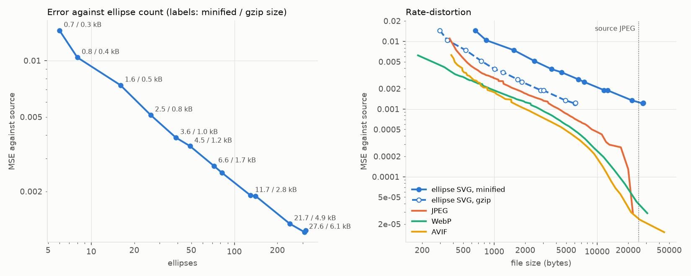
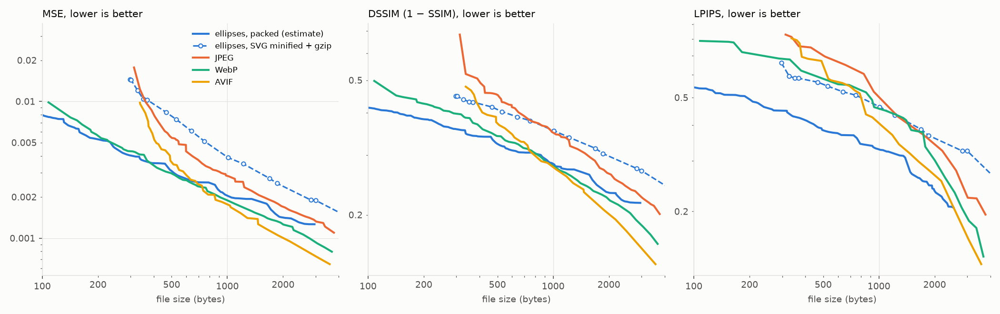
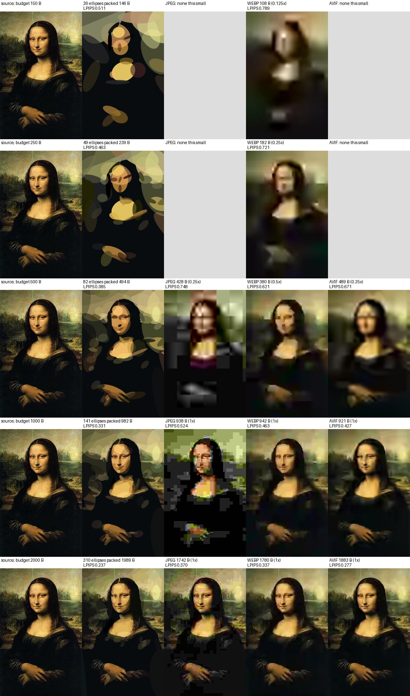

# Investigation: ellipses as very lossy image compression

Status: open, paused (November 2026). Single image; indicative, not settled.

Question: as the ellipse count grows, how does error against the source
compare with file size, and is there a size at which the representation is
worthwhile as compression? Later refined: the aim is perceptual likeness at
very small sizes, not parity with JPEG on squared error.

## Summary

- As minified, gzipped SVG, the ellipses lose to JPEG, WebP and AVIF on MSE
  at every size: by 1.4-1.7x (JPEG) to 2.2-3.1x (AVIF). Error against count
  is a power law, MSE ∝ N^-0.6, with no knee.
- A packed binary format (estimated, not implemented) needs 5-7 bytes per
  ellipse against ~19 for gzipped SVG. At that density the ellipses match
  WebP on MSE below ~500 B, lead on DSSIM below ~800 B, and lead every codec
  on LPIPS from 100 B to 3 kB.
- Whether the LPIPS lead reflects human judgement is unknown; see Caveats.

## Method

Source: `couch-db/_attachments/image/lisa.jpg`, 200x311. Runs: an 18-point λ
sweep, 3e-3 to 3e-7, default constants, 2500 steps (5000 below 3e-6),
giving 6 to 315 ellipses.

- `splatlisa/minify.py`: compact SVG. One decimal place, whole degrees,
  opacity folded into `#rrggbbaa`, angle normalised so that unrotated
  ellipses need no transform. Scored as written.
- `splatlisa/packed.py`: quantises each field group uniformly over a fixed
  range and counts `12 + ceil(N · bits / 8)` bytes; no bitstream is
  written. Groups: pos (cx, cy over [-1/4, 5/4] of the canvas), size (log2
  semi-axes), angle ([0, 180), wrapping), colour (per channel), alpha
  (never zero).
- `scripts/rd.py`: MSE against bytes at all sizes; SVG raw, gzip, brotli.
- `scripts/lowrate.py`: small sizes, with DSSIM and LPIPS (AlexNet). Per
  run, bits are removed greedily from the group costing least MSE per bit
  saved (10/8/8/8/8 down to a floor); every state is a point.
- Codecs via Pillow, swept over quality and resolution (1 to 1/8, upscaled
  bicubically), reduced to the lower envelope per measure. Encoded from an
  array: the source JPEG's ~1.3 kB colour profile is otherwise copied into
  WebP and AVIF.

```
cd splat
# λ sweep (one run per value; see the iterations in plan.md for timings)
uv run splatlisa ../couch-db/_attachments/image/lisa.jpg --lam 1e-4 --out out/rd/lam-1e-4
# All sizes, MSE
uv run --with matplotlib python scripts/rd.py ../couch-db/_attachments/image/lisa.jpg out/rd/lam-* --out out/rd/rd.png
# Small sizes, perceptual measures, packed estimate
uv run --with matplotlib --with lpips python scripts/lowrate.py ../couch-db/_attachments/image/lisa.jpg out/rd/lam-* \
    --budgets 150 250 500 1000 2000 --out out/rd/lowrate.png
```

## Results

### SVG at all sizes



- Minification at one decimal place costs ~0.5% MSE and removes ~32% of
  the bytes; whole pixels cost ~35% MSE. Per ellipse: ~89 bytes minified,
  ~19 gzipped, ~16 brotli.
- At equal gzipped size, codec MSE is lower by 1.4-1.7x (JPEG), 1.9-3.3x
  (WebP), 2.2-3.1x (AVIF); the gap widens with count.

### Packed format at small sizes



Best within each budget:

| budget | measure | packed | SVG gzip | JPEG   | WebP   | AVIF   |
|--------|---------|--------|----------|--------|--------|--------|
| 250 B  | MSE     | 0.0046 | -        | -      | 0.0049 | -      |
| 250 B  | LPIPS   | 0.46   | -        | -      | 0.72   | -      |
| 500 B  | MSE     | 0.0031 | 0.0083   | 0.0056 | 0.0030 | 0.0037 |
| 500 B  | LPIPS   | 0.39   | 0.57     | 0.75   | 0.62   | 0.67   |
| 1000 B | MSE     | 0.0021 | 0.0051   | 0.0029 | 0.0019 | 0.0018 |
| 1000 B | LPIPS   | 0.33   | 0.51     | 0.52   | 0.46   | 0.43   |
| 2000 B | LPIPS   | 0.24   | 0.37     | 0.37   | 0.34   | 0.28   |

- Best points use 37-55 bits per ellipse: pos 6-9, size 5-7, angle 3-6,
  colour 3-4 per channel, alpha 3-5. 82 ellipses take 494 B packed against
  1857 B as gzipped SVG.
- JPEG and AVIF cannot go below ~300-400 B; WebP reaches ~100 B only at
  1/8 resolution.



## Caveats

- LPIPS rewards sharp structure and penalises blur, which favours flat
  shapes over upscaled low-resolution codecs. Visually, the ellipses give a
  poster-like abstraction with clear face and hands; WebP at the same size
  is blurred but tonally closer. A human preference test is needed before
  any perceptual claim.
- One image, a painting with soft tonal structure.
- Bicubic upscaling stands in for the viewer; a better upscaler would help
  the codecs.
- The source is itself a JPEG; re-encoding near its quality favours JPEG at
  high rates (the drop near 20 kB), not at the sizes of interest.

## Open questions

Each would lower the ellipse curve; none has been tried.

- Quantisation-aware fine-tuning at the chosen bit widths.
- Entropy coding of the packed fields (positions and colours are far from
  uniform).
- Training against rate (bits) rather than count, and against a perceptual
  loss rather than L1 + SSIM.
- The corpus (`corpus.tsv`) rather than one image.
- A small human preference test at 250-1000 B.
- An actual decoder: an SVG generated from the packed bytes by a few lines
  of JavaScript would make the format usable in a page.
